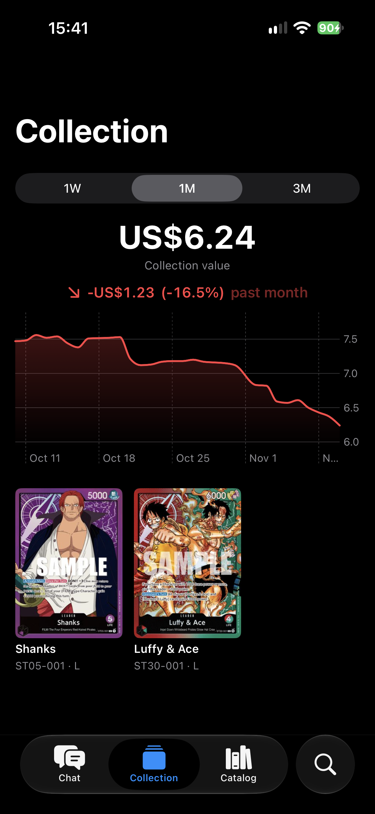
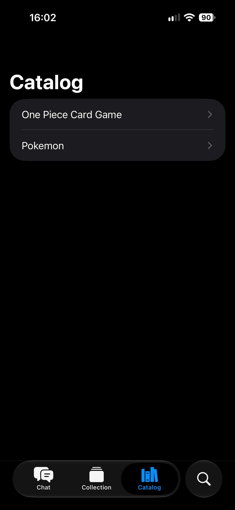
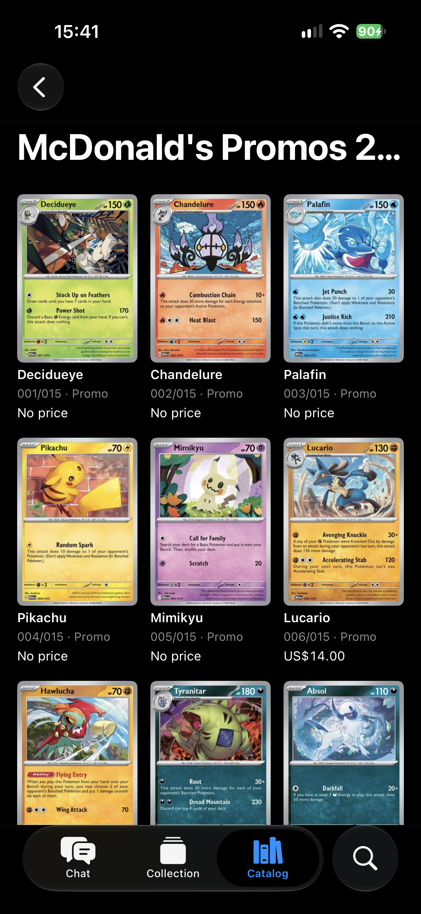
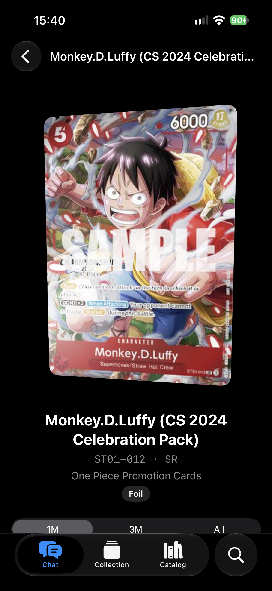
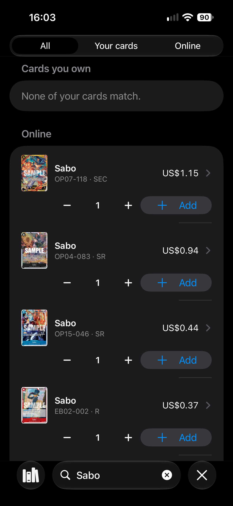
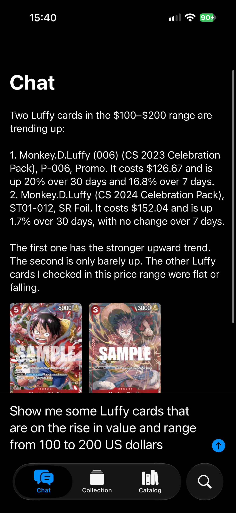

# TCGCollect

A SwiftUI app for collecting trading cards. Track the cards you own, see what your collection is worth over time, browse every One Piece and Pokémon set, and ask questions about prices in plain language.

Runs on iPhone, iPad, Mac and Apple Vision Pro.

## Screens

| Collection | Catalog | Set |
| :---: | :---: | :---: |
|  |  |  |
| Your cards, with the collection's value over the last week, month or three months. Long-press to remove copies. | One Piece and Pokémon, each with its sets, newest first, showing every set's icon, card count and release date. | Every card in a set with its current price, loading more as you scroll. |

| Card detail | Search | Chat |
| :---: | :---: | :---: |
|  |  |  |
| The card tilts with your phone, with a foil shine on foil printings. Shows the card's text and stats, its price history and how many copies you own. | Search your own cards and every card online at once, then add copies straight from the results. | Ask about prices and trends, like "show me Luffy cards between $100 and $200 that are going up", and get an answer with the cards it mentions. |

## Project layout

- **`TCGCollect/`** is the app: SwiftUI views, view models and presentations, grouped by feature (`Collection`, `Catalog`, `Search`, `Chat`, `CardDetail`). `App/` composes everything.
- **`Packages/AppCore`** holds everything that isn't UI:
  - `Domain`: plain models such as `Card`, `OwnedCard`, `CardSet` and `GameDetails`.
  - `Networking`: talks to the backend. Each endpoint is a `RemoteLoader` with its own request and response mapper, and requests retry while the server wakes up.
  - `Persistence`: the collection, saved with SwiftData. Nothing outside this module depends on SwiftData.
- **`Packages/HoloCard`**: the tilting holo/foil card view, in SwiftUI only.

Prices, card data and chat answers come from a separate backend service.

## Getting started

1. Open `TCGCollect.xcodeproj` in Xcode 26 or later.
2. Copy `Secrets.example.xcconfig` to `Secrets.xcconfig` and fill in `BACKEND_BASE_URL` and `BACKEND_API_KEY`. That file is git-ignored; never commit it.
3. Run the `TCGCollect` scheme.

To try the app without a backend, tick the `-sampleCards` launch argument in the scheme. It fills a debug build with sample cards. Untick it before committing.

## Tests

```sh
scripts/ci.sh
```

This runs the AppCore and HoloCard package tests and the app's unit tests on an iOS Simulator, the same as CI does on every pull request into `main`.

End-to-end tests call a real backend. They skip themselves unless you set these environment variables:

```sh
E2E_BASE_URL=https://your-backend E2E_API_KEY=your-key \
  swift test --package-path Packages/AppCore --filter NetworkingEndToEndTests
```
